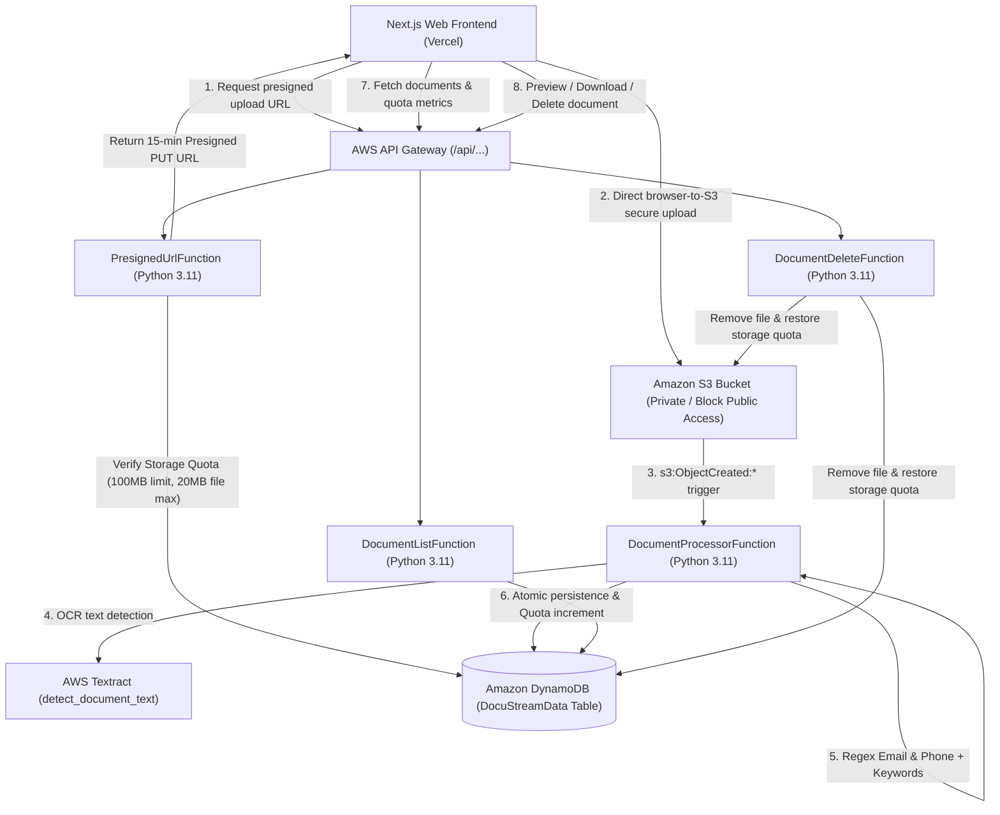

# DocuStream Web

> Production-Ready Serverless Document Processing Platform powered by Next.js 14, AWS S3, Textract OCR, AWS Lambda (Python 3.11), DynamoDB, and Amazon API Gateway.

[](https://opensource.org/licenses/MIT)
[](https://aws.amazon.com/serverless/sam/)
[](https://nextjs.org/)
[](https://www.typescriptlang.org/)
[](https://vercel.com/)

---

## 1. System Architecture



---

## 2. Key Features

- **Direct-to-S3 Secure Uploads**: Bypasses server payload limits using secure, time-limited presigned PUT URLs with CORS pre-flight support.
- **Automated Document Intelligence**: Triggered automatically on S3 object creation; uses AWS Textract OCR with fallback text parsing and regex extraction for emails, phone numbers, and keywords.
- **Multi-Tenant User Quotas**: Atomic DynamoDB quota counters enforce per-user storage caps (e.g., 100 MB max quota, 20 MB max file size).
- **Single-Table DynamoDB Architecture**: Optimized partition and sort key design (`USER#<id>`, `DOC#<id>`, `METRICS#USAGE`) with point-in-time recovery and AES-256 server-side encryption.
- **Dual-Action Document Access**: Separate signed URLs for instant browser **Preview** (`Content-Disposition: inline`) and direct **Download** (`Content-Disposition: attachment`).
- **Resilient Fallback Mode**: The Next.js frontend includes local Edge mock routes (`/api/*`) for local development without active AWS credentials.

---

## 3. Project Directory Structure

```text
.
├── .gitignore                  # Root gitignore (excludes .env*, .aws-sam, .venv, etc.)
├── template.yaml               # AWS SAM Infrastructure as Code (IaC) template
├── samconfig.toml.example      # Example configuration for AWS SAM deployment
├── requirements.txt            # Backend Python testing and build dependencies
├── deploy_backend.sh           # Automated SAM build, test, and CloudFormation deploy script
├── deploy_frontend.sh          # Automated Vercel CLI build and deploy script
├── README.md                   # Project documentation & setup instructions
├── src/                        # AWS Lambda microservices (Python 3.11)
│   ├── __init__.py
│   ├── utils.py                # CORS headers, Decimal encoder, regexes & boto3 clients
│   ├── get_presigned_url.py    # GET /api/upload-url: Validates quota & creates PUT URL
│   ├── process_document.py     # S3 Event Trigger: Textract OCR + Regex metadata extractor
│   ├── list_documents.py       # GET /api/documents: Lists documents & quota metrics
│   └── delete_document.py      # DELETE /api/documents/{docId}: Purges S3 & restores quota
├── tests/                      # Pytest unit test suite
│   ├── __init__.py
│   ├── conftest.py             # Moto AWS fixtures (mock S3, DynamoDB, credentials)
│   └── test_backend.py         # 10 unit tests covering quota, upload, OCR, and deletion
└── frontend/                   # Next.js 14 App Router (TypeScript + Tailwind CSS)
    ├── package.json
    ├── tsconfig.json
    ├── tailwind.config.js
    ├── next.config.mjs
    ├── vercel.json             # Vercel security headers and framework routing
    ├── .gitignore              # Frontend gitignore (excludes .next, node_modules, etc.)
    ├── .env.example            # Environment template for frontend
    ├── app/                    # Next.js App Router & API routes
    ├── components/             # Reactive UI components (UploadDropzone, StorageMeter, etc.)
    └── lib/                    # API client (lib/api.ts) & TypeScript interfaces
```

---

## 4. Getting Started

### Prerequisites

1. **Node.js**: `v18.x` or later (LTS recommended)
2. **Python**: `3.11` or later
3. **AWS CLI**: Installed and configured (`aws configure`)
4. **AWS SAM CLI**: Installed ([AWS SAM installation guide](https://docs.aws.amazon.com/serverless-application-model/latest/developerguide/install-sam-cli.html))

---

### Step 1: Clone Repository & Setup Environment

```bash
git clone https://github.com/your-username/docustream-web.git
cd docustream-web

# Install frontend dependencies
npm --prefix frontend install
```

#### Security & Environment Variables
**Never commit sensitive credentials to Git.** All secret keys, AWS account details, and `.env*.local` files are ignored by `.gitignore`.

1. **Frontend Environment**:
   ```bash
   cp frontend/.env.example frontend/.env.local
   ```
   Edit `frontend/.env.local` to point to your deployed API Gateway stage (or leave blank to use built-in local mock mode):
   ```env
   NEXT_PUBLIC_API_GATEWAY_URL=https://your-api-gateway-id.execute-api.us-east-1.amazonaws.com/prod
   NEXT_PUBLIC_DEFAULT_USER_ID=user-demo-1
   ```

2. **AWS SAM Configuration**:
   ```bash
   cp samconfig.toml.example samconfig.toml
   ```

---

### Step 2: Deploy Backend Infrastructure (AWS)

Ensure your AWS CLI credentials are active:
```bash
aws sts get-caller-identity
```

Deploy using the automated deployment script:
```bash
npm run deploy:backend
# Or directly: ./deploy_backend.sh
```

This script automatically:
1. Runs the Pytest unit test suite against mocked AWS services.
2. Builds SAM Lambda artifacts (`sam build --parallel`).
3. Provisions the AWS CloudFormation stack (S3 bucket, DynamoDB table, IAM execution roles, and API Gateway).
4. Automatically writes the deployed `NEXT_PUBLIC_API_GATEWAY_URL` into `frontend/.env.local`.

---

### Step 3: Run Frontend Locally

```bash
npm run dev
# Or: cd frontend && npm run dev
```

Open [http://localhost:3000](http://localhost:3000) in your browser.

---

### Step 4: Deploy Frontend to Vercel Production

#### Option A: One-Command CLI Deployment
```bash
npm run deploy:frontend
# Or directly: ./deploy_frontend.sh
```
The script builds the Next.js project locally to verify static generation, invokes the Vercel CLI (`npx vercel --prod`), and automatically injects `NEXT_PUBLIC_API_GATEWAY_URL` as both a build-time and runtime environment variable.

#### Option B: Deploy via Vercel Git Dashboard
1. Push your repository to GitHub.
2. Go to [Vercel Dashboard](https://vercel.com/dashboard) and click **"Add New Project"**.
3. Import your GitHub repository.
4. Set **Root Directory** to `frontend`.
5. Under **Environment Variables**, add:
   - **Key**: `NEXT_PUBLIC_API_GATEWAY_URL`
   - **Value**: `https://your-api-gateway-id.execute-api.us-east-1.amazonaws.com/prod`
6. Click **Deploy**.

---

## 5. Testing & Verification

### Backend Unit Tests (Pytest + Moto)
```bash
# Using virtual environment
python3 -m venv .venv
source .venv/bin/activate
pip install -r requirements.txt
pytest tests/test_backend.py -v
```
Verifies:
- Presigned URL generation and rejection when quota is exceeded.
- S3 event handling, Textract OCR parsing, and regex extraction.
- Atomic DynamoDB storage quota updates and deletions.

### Frontend Production Build
```bash
npm run build
# Or: cd frontend && npm run build
```
Confirms all Next.js App Router pages and dynamic routes compile cleanly with zero TypeScript errors.

---

## 6. Security & Infrastructure Highlights

- **No Hardcoded Credentials**: Infrastructure and Lambda functions use dynamic AWS CloudFormation references (`!Sub`, `AWS::AccountId`, `AWS::Region`).
- **Private S3 Storage**: S3 bucket blocks all public ACLs and bucket policies. Content is accessible exclusively via short-lived presigned URLs.
- **CORS Configuration**: Restricts S3 and API Gateway access to authorized origins (`localhost:3000` and Vercel domains).
- **Least Privilege IAM**: Lambda roles are strictly scoped to the dedicated DynamoDB table and S3 bucket ARN.
- **Git Hygiene**: Comprehensive `.gitignore` guards prevent accidental leakage of `.env`, `samconfig.toml`, `.aws-sam/`, `.venv/`, or build artifacts.

---

## 7. License

This project is licensed under the [MIT License](LICENSE).
